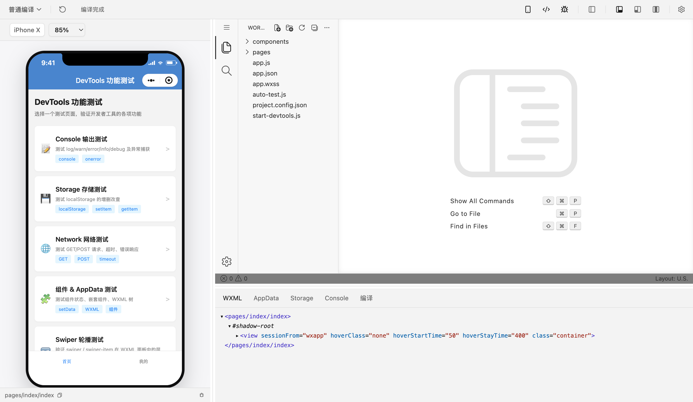

# Dimina Studio

[Dimina](https://github.com/didi/dimina) 小程序的开发工具。桌面应用用来打开、运行和调试项目；编译、H5 预览和 Electron 运行时也可以单独装进自己的程序。

[](https://github.com/lbb00/dimina-studio/actions/workflows/ci.yml)
[](https://github.com/lbb00/dimina-studio/releases/latest)
[](./LICENSE)



[下载桌面工具](https://github.com/lbb00/dimina-studio/releases) · [从源码构建](#从源码启动) · [产品主页](https://lbb00.github.io/dimina-studio/)

## 桌面工具

从 [Releases](https://github.com/lbb00/dimina-studio/releases) 下载 Dimina DevTools。macOS 提供 Intel 和 Apple Silicon 的 `.dmg`，Windows 提供 `.zip`，Linux 提供 `.tar.gz`。

打开项目后，同一个窗口里有模拟器、编辑器，以及 WXML、AppData、Storage、Console 和编译面板。AppData 可以改完写回。也可以接上 Chrome DevTools。

保存样式文件时，开发工具会尽量热更新样式，页面里的数据保持不变。保存 JavaScript、模板或其他需要整页刷新的文件时，模拟器会重新启动，内存里的状态会清空；项目的 Storage 会留下。

## 嵌入开发包

只需要编译和 H5 预览时，安装 `@dimina-studio/devkit`：

```bash
pnpm add @dimina-studio/devkit
```

```typescript
import { openProject } from '@dimina-studio/devkit'

const session = await openProject({ projectPath: '/path/to/miniapp', port: 0 })
console.log(`预览地址: http://localhost:${session.port}`)
```

各包怎么装、怎么调用，写在各自的 README 里。

## 包一览

直接使用的包：

| 包 | 说明 |
| --- | --- |
| [`@dimina-studio/devtools`](./packages/devtools) | Electron 桌面工具：模拟器、Chrome DevTools、调试面板和编辑器 |
| [`@dimina-studio/devkit`](./packages/devkit) | 编译小程序、启动 H5 预览，并在文件变化后重新编译。DevTools 也用它编译项目 |
| [`@dimina-studio/compiler`](./packages/compiler) | 在浏览器或 Node.js 里编译小程序。读取文件的方法由调用方传入 |
| [`@dimina-studio/electron-runtime`](./packages/dimina-electron-runtime) | 在现有 Electron 应用里运行 Dimina 小程序 |

做自己的开发工具时还会用到：

| 包 | 说明 |
| --- | --- |
| [`@dimina-studio/workbench`](./packages/workbench) | 可嵌进网页的代码编辑器，支持 WXML、类型提示和配置检查 |
| [`@dimina-studio/inspect`](./packages/inspect) | 从正在运行的页面读取 WXML 树，并提供 WXML、Storage、AppData 和编译信息面板 |
| [`@dimina-studio/design`](./packages/design) | 桌面界面共用的颜色、基础样式、可拖动面板样式和 Tailwind 配置 |

DevTools 用 devkit 编译，devkit 用 compiler。electron-runtime、workbench、inspect 和 design 由 DevTools 组装进桌面应用。

不发布到 npm：`@dimina-studio/eslint-config`、`@dimina-studio/typescript-config`，以及 [`tools/pawl`](./tools/pawl)。

## 从源码启动

Node.js 24（见 [`.node-version`](./.node-version)）和 pnpm 12.3.4。发布到 npm 的包声明支持 Node.js 20 及以上；从本仓库构建请用上面的版本。

```bash
git clone --recurse-submodules https://github.com/lbb00/dimina-studio.git
cd dimina-studio

pnpm install
pnpm -C dimina/fe install

pnpm --filter @dimina-studio/devtools build:container
pnpm build
pnpm --filter @dimina-studio/devtools start
```

`dimina/` 是上游框架的 Git 子模块，编译器构建会读它的源码。本仓库不改子模块里的文件。

改桌面工具时用 `pnpm --filter @dimina-studio/devtools dev`。它会先构建，再监听源码并启动 Electron。

在仓库根目录还可以运行：

```bash
pnpm build
pnpm test
pnpm lint
pnpm check-types
pnpm pawl:check
```

## 参与

提交 issue 和 pull request 前先看 [CONTRIBUTING.md](./CONTRIBUTING.md)。社区互动遵循 [行为准则](./CODE_OF_CONDUCT.md)。安全问题按 [SECURITY.md](./SECURITY.md) 私下报告。

## License

[MIT](./LICENSE) © lbb00

第三方依赖的许可声明见 [THIRD_PARTY_NOTICES.md](./THIRD_PARTY_NOTICES.md)。
