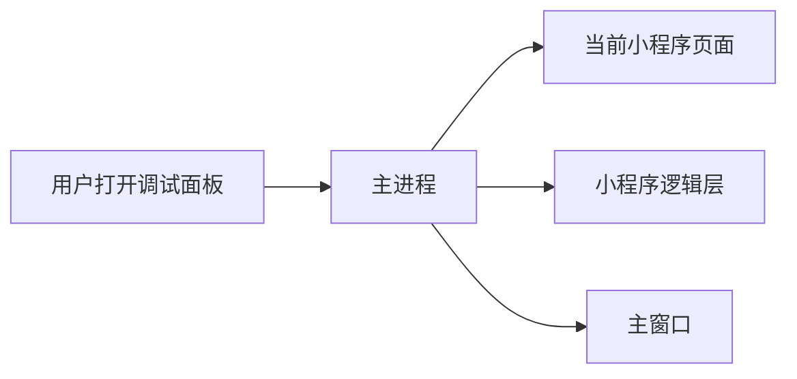

# 调试面板怎样取得数据

用户打开右侧 Chrome DevTools 后，会在 Elements 看页面结构，在 Console 看日志，在 Network 看请求。这三类信息不一定来自同一个网页，因此由主进程用 Chrome DevTools Protocol（CDP）转发。

## 正常流程

Elements 请求送到当前小程序页面。Console 主要读取小程序逻辑层。Network 汇集页面和主进程记录的请求。CDP 当前连接的网页称为“被调试的页面”。

## 谁负责什么

主进程选择当前项目对应的被调试网页，并在页面切换时替换连接。调试面板只发送已支持的调试请求。它不能借此执行主窗口代码或访问本机文件。

页面切换、重载或关闭项目后，旧 DOM 节点、请求 ID 和 JavaScript 执行环境都会失效。界面必须重新读取当前页面的信息。

## 出问题先查什么

- Elements 显示旧页面：确认当前项目和路由已切换，再检查页面连接是否更新。
- Console 没有日志：检查逻辑层窗口是否还在运行。
- Network 缺记录：检查请求来自页面还是主进程，再看对应记录服务。

相关代码在 `src/main/services/`、`src/main/services/views/` 和 `src/main/services/workspace/`。
