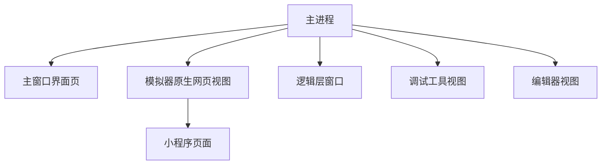
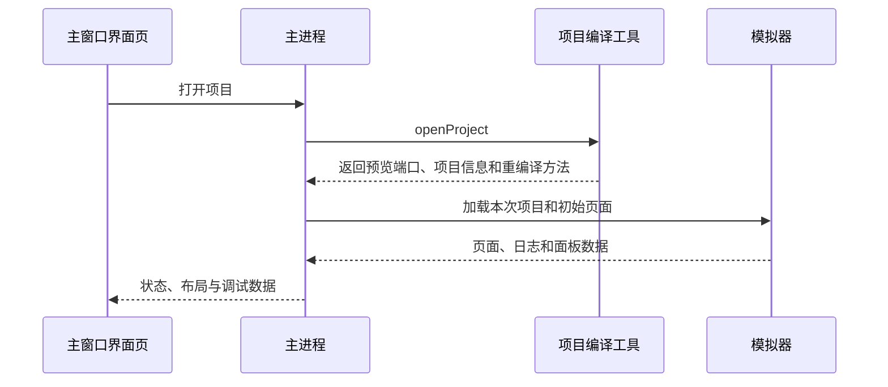

# DevTools 总体架构

用户在项目列表点“打开”后，DevTools 会编译项目、显示模拟器，并按需要打开编辑器和调试工具。窗口、消息和原生网页视图都由主进程创建。

主进程负责创建窗口、运行项目和处理消息。界面页（`renderer`）是用户看到的 React 页面，只提交操作和位置。Electron 原生网页视图（`WebContentsView`）由主进程放进窗口，用来显示模拟器、编辑器和调试工具。术语见[术语表](./glossary.md)。

## 拓扑

图的重点是：界面页不直接管理原生网页视图。它上报位置和是否显示；主进程中的 `ViewManager` 统一创建、移动、隐藏和释放视图。

## 主要数据流

项目文件由编译工具读取。编辑器通过[为编辑器提供文件的本机网页服务](./glossary.md#为编辑器提供文件的本机网页服务coi-server)和 `project-fs` 读取项目文件，保存时写回磁盘。

## 画面不对时先看哪里

- 模拟器不见了或盖住按钮：检查[项目窗口布局](./project-window-layout.md)上报的位置。
- 项目能编译却没有页面：检查[模拟器渲染](./simulator-render-architecture.md)的页面就绪过程。
- 控制台或 Elements 看错页面：检查[调试工具路由](./devtools-cdp-routing.mdx)。

## 消息如何传递

Electron 进程消息（IPC）由主进程注册。主进程会检查消息来自哪个窗口，也会检查参数。界面页、预加载脚本（`preload`）、模拟器和逻辑层窗口只能调用各自需要的方法。新增消息名时，要同时说明参数格式、谁能发送、关闭时怎样清理，以及失败时返回什么。

不要让不受信任的页面使用 Node.js、发送任意进程消息，或在主窗口中执行调试代码。应用自己创建的窗口必须登记为可信窗口，而且只能打开预期的网址。

## 启动与关闭

启动时先完成 Electron 初始化，再创建主窗口和所需服务。打开项目后开始编译，并加载模拟器和其他原生网页视图。关闭项目会调用 `ViewManager.disposeProjectViews()`，关闭模拟器、Chromium DevTools 和编辑器，并清理安全区信息。属于整个应用的工具条、侧边栏和对话框可以保留。关闭应用时，先停止接收新请求，再关闭项目、窗口、视图和监听器。

等待中的任务返回结果时，必须确认原来的项目仍然打开。切换项目、关闭窗口或替换视图后才返回的旧结果，不能重新显示旧内容。

## 维护入口

- `src/main/app/`：应用启动和公开 `launch()`。
- `src/main/services/views/`：原生网页视图及其位置。
- `src/main/services/workspace/`：当前项目与编译状态。
- `src/main/ipc/`：注册主进程消息和读写项目文件。
- `src/renderer/`：主窗口界面和布局。

相关专题见[项目窗口布局](./project-window-layout.md)、[模拟器渲染](./simulator-render-architecture.md)和[小程序逻辑层与页面通信](./native-bridge-protocol.md)。
