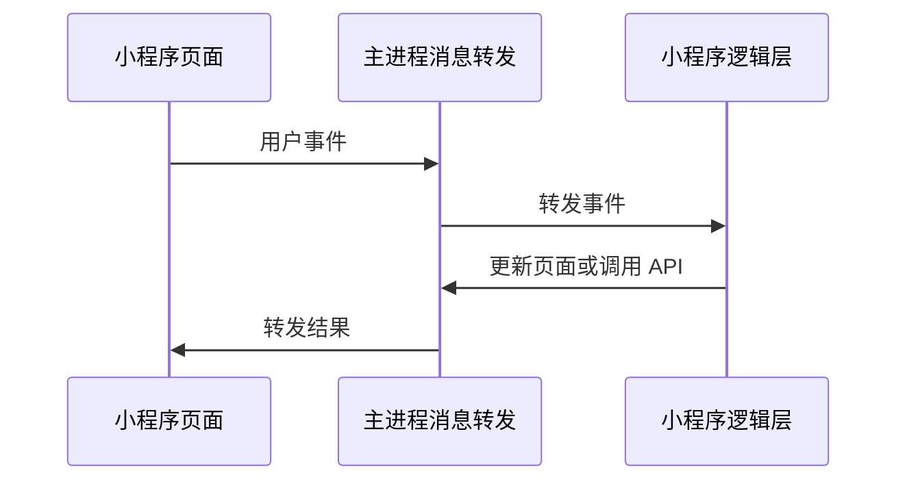

# 小程序逻辑层和页面如何通信

用户点击按钮后，页面事件要送到小程序逻辑代码。逻辑代码更新数据后，页面也要立刻重画。逻辑代码运行在隐藏的逻辑层窗口（`service-host`）；用户看到的页面运行在小程序页面容器（`render-host` `<webview>`）中。代码把这套主进程消息转发称为 `Native Bridge`。

## 正常流程

例如用户点按钮时，页面先把事件交给主进程。主进程验证消息名称和参数后，再交给逻辑层。逻辑层产生的新数据按相反方向返回页面。

## 关键规则

每次打开项目都是一次独立运行。项目切换或关闭后，旧页面和旧逻辑层迟到的消息不能更新新项目。页面也不能借消息转发直接访问任意 Electron 或 Node.js 能力。

预热窗口归还时只清除 JavaScript 执行环境。默认共享存储不会自动清空。

## 出问题先查什么

- 点击没有反应：检查页面事件是否进入主进程。
- 数据变了但画面不变：检查主进程是否把更新转发回当前页面。
- 切换项目后看到旧数据：检查旧项目消息是否被忽略。

相关代码在 `packages/dimina-electron-runtime/src/main/ipc/bridge-router.ts`、`packages/dimina-electron-runtime/src/simulator-ui/`、`src/service-host/` 和 `src/simulator/`。
