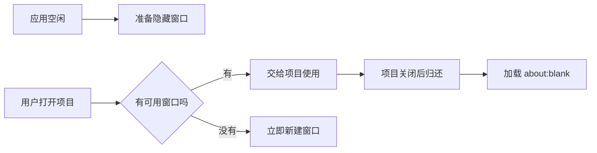

# 为什么第二次打开项目更快

第一次打开项目时，应用需要创建并加载隐藏的小程序逻辑层窗口。预热窗口池会提前准备几个窗口，因此下一次打开可以少等一段加载时间。它默认关闭，普通使用不会多占内存。

## 正常流程

设置 `DIMINA_PREWARM_POOL_SIZE` 为 1 到 4 的整数可开启。`DIMINA_PREWARM_DISABLE=1` 会强制关闭。没有可用预热窗口时，应用直接新建普通窗口，不会阻止用户打开项目。

## 归还后会清理什么

窗口归还时会加载 `about:blank`，清除页面和 JavaScript 执行环境。默认共享存储区不会清空，因此 Cookie 和本地存储可能保留。普通窗口使用完后直接销毁；配置不匹配的预热窗口也会销毁。

## 出问题先查什么

- 第二次打开仍很慢：确认环境变量已启用，且预热窗口已经准备好。
- 新项目读到旧存储：这是共享存储的结果，检查应用是否应该主动清理这些数据。
- 关闭后窗口残留：检查关闭项目的代码是否把窗口放回预热集合或将它销毁。

相关代码在 `packages/dimina-electron-runtime/src/main/services/service-host-pool/`。
