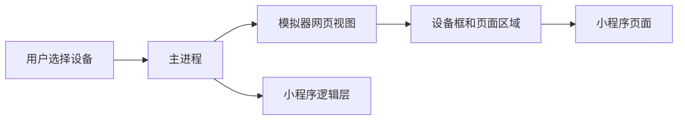

# 模拟器怎样显示小程序

用户先选一台设备，再打开项目。随后会看到设备外框、导航栏、页面和 TabBar。编辑代码后，新页面准备好时才会替换旧页面。

## 正常流程

最外层设备框画边框、屏幕大小、状态栏和 Home 指示条。`DeviceShell` 接入所选设备。`MiniAppFrame` 画导航栏、页面区域和 TabBar。每个小程序页面都显示在自己的页面容器（`render-host` `<webview>`）中。

重新编译时，新页面先在看不见的位置加载。收到 `DOM_READY` 后才显示。如果页面没有准备好，主进程会重新创建它。设备和缩放先交给主进程，再送到模拟器和逻辑层。

## 谁负责什么

主进程负责创建模拟器网页视图和设置缩放。设备框只画外观。页面区域只显示小程序页面。应用扩展只能调用已经注册的方法，不能直接管理模拟器网页视图或逻辑层窗口。

## 出问题先查什么

- 设备框尺寸不对：检查 `src/simulator/device-shell/` 和安全区服务。
- 页面一直空白：检查 `src/main/services/views/native-simulator-view.ts` 与页面就绪消息。
- 刷新后又显示旧页面：检查返回结果是否仍属于当前项目，旧项目的结果必须忽略。

相关代码还包括 `packages/dimina-electron-runtime/src/simulator-ui/` 和 `src/main/services/workspace/`。
